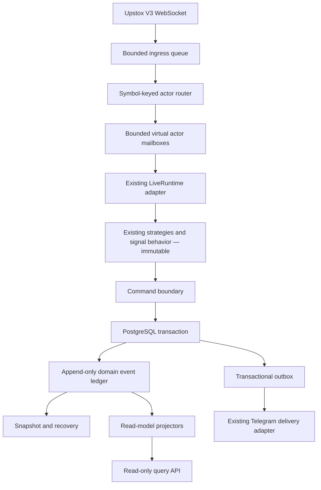

# Target Architecture — Hybrid Virtual Actors, CQRS and Event Sourcing

**Status:** proposal for staged, shadow-first implementation. This document does not authorize production cutover.
**Invariant:** all existing signal-generation modules, indicator calculations, strategy configuration, entry/exit behavior, risk calculations, alert conditions and message formatting remain functionally identical.

## 1. Deployment shape

Keep a single modular-monolith process on Render initially. Use bounded asyncio tasks and in-process virtual actors; do not create one process per symbol and do not introduce distributed microservices. PostgreSQL remains the durable store. A future multi-instance deployment requires an explicit partition/lease design and is not part of the first rollout.

## 2. Component diagram

## 3. Actor model

- One logical actor per instrument key; actor identity is stable and independent of task identity.
- Actor state is private to its mailbox consumer. Only that consumer mutates it.
- One bounded mailbox per active actor, with a global bounded ingress queue and a hard cap on active actors.
- Sequential processing within one actor; concurrency across actors under a configured semaphore/worker budget.
- No unbounded task-per-message pattern. Backpressure is explicit: reject/defer ingress or pause upstream reads; never silently drop accepted durable commands.
- Each command carries event/message ID, entity ID, sequence/version expectation, correlation ID and causation ID.
- Duplicate IDs are idempotently acknowledged from durable dedupe records.
- Actor exceptions are isolated, reported and restarted from the last committed snapshot plus event replay.
- Shutdown stops ingress, drains within a deadline, persists checkpoints and then cancels remaining work with visible diagnostics.

### Lifecycle

`CREATED -> RECOVERING -> READY -> DRAINING -> STOPPED`

A recovery gap, invalid snapshot or corrupt event moves the actor to `FAILED_SAFE`; it must not silently skip records or process new state-changing commands.

## 4. CQRS and event flow

**Command side:** validate command envelope and expected aggregate version; execute existing application operation through an adapter; append all state-transition events and outbox records in one PostgreSQL transaction; increment aggregate sequence; commit; then publish an in-process wake-up notification.

**Query side:** projections consume committed events in sequence and maintain read-only dashboard/status views with their own checkpoints. Queries never mutate actor state. Projection rebuilds read only the event ledger.

The existing signal modules remain called through a compatibility adapter. Architecture code wraps their invocation; it does not alter strategy source, settings, parameters, candle inputs, ordering or signal conditions.

## 5. Event ledger schema (additive)

Proposed `domain_events` fields:

- `event_id UUID PRIMARY KEY`
- `aggregate_type TEXT NOT NULL`
- `aggregate_id TEXT NOT NULL`
- `sequence BIGINT NOT NULL`
- `event_type TEXT NOT NULL`
- `schema_version INTEGER NOT NULL`
- `occurred_at TIMESTAMPTZ NOT NULL` (UTC)
- `recorded_at TIMESTAMPTZ NOT NULL DEFAULT now()`
- `correlation_id UUID`, `causation_id UUID`
- `idempotency_key TEXT NOT NULL`
- `payload JSONB NOT NULL`
- `metadata JSONB NOT NULL DEFAULT '{}'`
- Unique constraints on `(aggregate_type, aggregate_id, sequence)` and `idempotency_key`.

Append uses a transaction and optimistic concurrency: lock/check aggregate version, require next sequence exactly previous+1, insert event, update aggregate head/version, and insert outbox rows. A unique constraint is the final race guard. Duplicate idempotency key returns the original result; sequence conflict is explicit and retryable only after reloading current state.

## 6. Snapshots and recovery

Proposed `aggregate_snapshots` fields: aggregate type/id, event sequence, state schema version, serialized state JSONB, checksum, created_at UTC. Snapshots are accelerators, never authoritative.

Recovery algorithm:
1. Select latest snapshot with supported schema and valid checksum.
2. Load events after snapshot sequence in bounded pages, ordered by sequence.
3. Require contiguous sequence values and supported event schema versions.
4. Apply pure reducers only; reducers cannot call network APIs or send alerts.
5. Compare final sequence with aggregate head.
6. Mark actor ready only after consistency checks pass.
7. If a gap/corruption/schema incompatibility exists, fail safe and expose exact aggregate/sequence diagnostics.

Snapshot creation must capture state at a committed sequence boundary. Replay runs in a side-effect-free context; outbox dispatch is a separate live consumer and is never invoked by replay.

## 7. Transactional outbox

Keep existing Telegram alert types and payload format. In the same DB transaction as a state-changing event, persist the existing alert delivery intent and a stable idempotency key. Workers claim rows using short transactions and row-level locking/leases. Retry transient errors with capped exponential backoff plus jitter, classify permanent errors, and move exhausted records to a dead-letter state for operator review.

Telegram Bot API does not expose a general idempotency key for sendMessage; therefore exactly-once external delivery cannot be promised. The system can guarantee durable intent and at-least-once delivery, minimize duplicates, and make ambiguous outcomes visible. Never claim mathematical exactly-once Telegram delivery.

## 8. Readiness and observability

- `/health`: process liveness only; no external dependency fan-out.
- `/ready`: ready only when DB, required startup tasks, universe validation, actor recovery and feed criteria are met. Return a non-2xx response while not ready.
- `/status`: authenticated operational diagnostics; redact secrets and connection details.
- Metrics: actor count/state, mailbox depth, queue wait, processed/failed messages, append latency, replay/snapshot duration, outbox pending/oldest age/failures, DB pool state, worker utilization, feed reconnects/staleness, CPU and memory.

Do not expose credentials, tokens, private URLs, connection strings or sensitive payload data. Health endpoint response compatibility should be preserved where possible; introduce new routes additively.

## 9. Migration plan

1. Add new schema through versioned additive migration; no destructive changes.
2. Backfill only where semantics are provable; preserve original rows and IDs.
3. Dual-write only in shadow mode with transactionally consistent event records; compare derived state against existing tables.
4. Run event replay and projection rebuild against copied/non-authoritative data.
5. Verify state transition and outbox parity over representative sessions.
6. Propose authoritative cutover only after all gates pass and explicit approval.
7. Retain rollback path to the old runtime and schema; never drop old tables during initial rollout.

## 10. Failure policy

| Failure | Required response |
|---|---|
| Actor mailbox full | Apply ingress backpressure; explicit overload metric; no silent drop |
| Duplicate event/message | Idempotent acknowledgement |
| Sequence conflict/gap | Stop affected actor and expose diagnostic |
| DB unavailable | Stop accepting state-changing commands; bounded reconnect/backoff |
| Snapshot corrupt | Fall back to prior valid snapshot; if none, replay from ledger or fail safe |
| Unsupported event schema | Fail safe; operator-visible compatibility error |
| Telegram outage | Preserve outbox; capped retry with jitter and dead-letter visibility |
| WebSocket disconnect | Existing reconnect behavior; actor state remains isolated |
| Process shutdown | Stop ingress, bounded drain, checkpoint and close resources |
| Projection failure | Retry/rebuild projection; do not block authoritative event append |

## 11. Quality gates

No production-ready claim until actor ordering/backpressure, event append/replay, snapshot consistency, PostgreSQL concurrency, outbox behavior, full regression suite, API compatibility, secret audit, resource profiling, shadow parity and rollback drill all have recorded PASS evidence. Untested gates remain NOT TESTED or BLOCKED.
